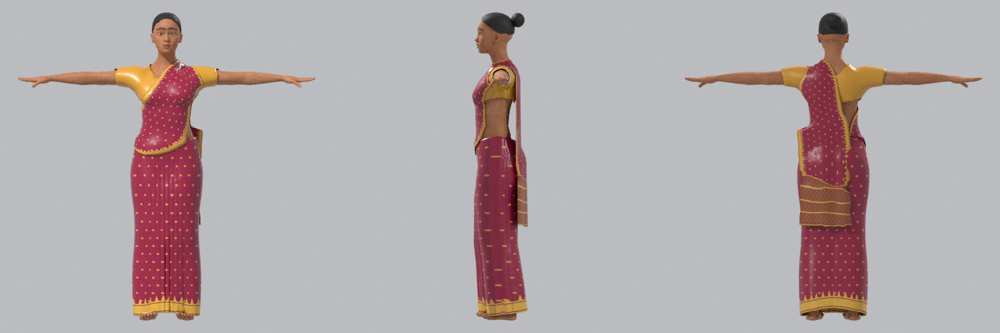
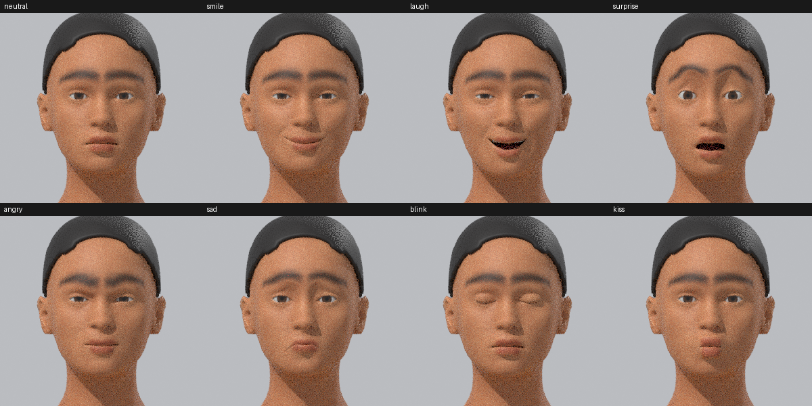
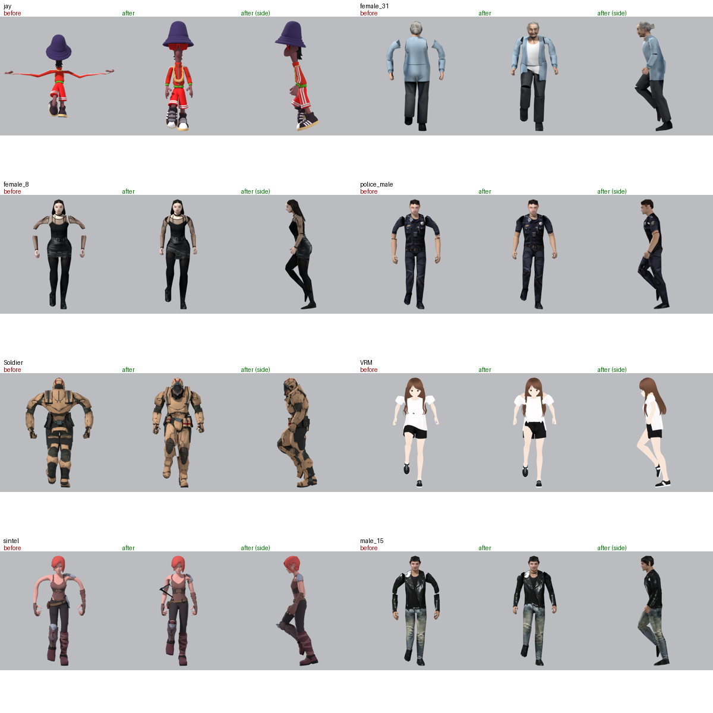
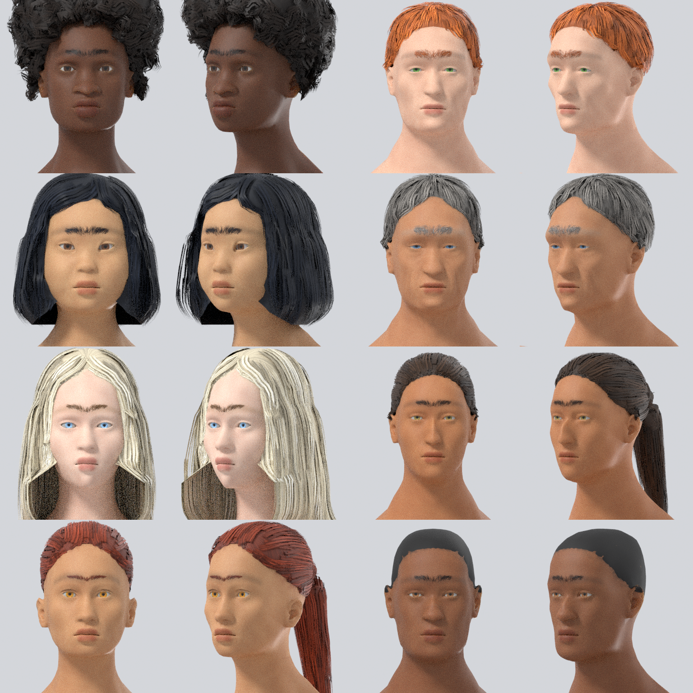

<p align="center">
  <picture>
    <source media="(prefers-color-scheme: dark)" srcset="docs/images/logo-dark.png">
    
  </picture>
</p>

<h1 align="center">sasori</h1>

<p align="center"><b>Rigged, game-ready 3D humans from the command line. Built for AI agents.</b><br>
Body, face, hair and clothes in, an animated GLB with a body rig and a face rig out.</p>

<div align="center">

[](https://github.com/alokdidde/sasori/actions/workflows/ci.yml)
[](https://github.com/alokdidde/sasori/releases)
[](LICENSE)


</div>

<p align="center">
  
</p>

<p align="center">
  <a href="docs/README.md">Docs</a> · <a href="docs/installation.md">Install</a> ·
  <a href="docs/getting-started.md">Getting started</a> · <a href="docs/cli-reference.md">CLI reference</a> ·
  <a href="docs/agents.md">For AI agents</a>
</p>

## Features

| | |
|---|---|
| **Body** | MakeHuman base mesh, Character-Creator-style sliders (gender, age, muscle, weight, height, ethnicity, ...) and 238 detail morphs |
| **Face** | 68 symmetric face sliders, 10 archetypes, seeded random faces; skin, eye and eyebrow controls; named colours |
| **Hair** | 11 card-based styles (incl. braids) grown from the scalp, strand eyebrows, or your own hair mesh |
| **Clothes** | 19 garments fitted and layered on any body, fabric relief, repaintable UV templates |
| **Body rig** | Mesh2Motion human skeleton, 87 animation clips |
| **Face rig** | 52 ARKit blendshapes on every character |
| **Auto-rig** | puts the same skeleton on any humanoid mesh |
| **Agent-first** | one JSON object per command, error codes with hints, renders to check the result, built-in guide |

## Rigging

**Body rig.** Every character is skinned to the exact [Mesh2Motion](https://mesh2motion.org) human
skeleton: 65 bones plus `root`, Unreal-style names (`pelvis`, `spine_01..03`, `upperarm_l`, `thigh_r`, ...),
T-pose rest. Mesh2Motion clips play unchanged, and the names follow the Unreal mannequin convention.

```bash
sasori animations                              # 87 clips: Idle_A, Walk, Jog, Sprint, Sword_Attack, ...
sasori build --animations Idle_A,Walk,Jog      # bake clips into the GLB
sasori render --animation Jog --frame 0.3      # check deformation mid-stride
sasori validate build/hero.glb                 # bone names, hierarchy, rest pose, weights, blendshapes
```

**Face rig.** Every build carries the **52 ARKit blendshapes** (`jawOpen`, `eyeBlinkLeft`,
`mouthSmileRight`, ...) as named glTF morph targets at weight 0, generated per character so they fit any
face. Face capture (Live Link Face, ARKit, MediaPipe) and lip-sync tools drive them by name.

```bash
sasori render --focus head --expression smile             # smile laugh surprise angry sad blink kiss
sasori render --focus head --expression "jawOpen=0.6,eyeBlinkLeft=1"
sasori catalog expressions                                # the 52 names
sasori set face.blendshapes=none                          # leave the face rig out
```

<p align="center"></p>

**Auto-rig.** Rig any upright humanoid (GLB/glTF/OBJ/FBX, T- or A-pose, dressed, realistic or cartoon)
to the same skeleton:

```bash
sasori autorig knight.glb --out knight_rigged.glb --animations Idle_A,Walk --render ./check
```

<p align="center"></p>

## Install

Download the bundle for your platform from the [latest release](https://github.com/alokdidde/sasori/releases/latest)
and run `./sasori --help` (`sasori.cmd --help` on Windows). It includes Python 3.13 and Blender, so
nothing else is needed. Linux x64, macOS Apple Silicon, Windows x64 and ARM64.

Or, with Python 3.13: `uv tool install --python 3.13 git+https://github.com/alokdidde/sasori`

Runs headless on the CPU. [More options and troubleshooting](docs/installation.md).

## Quick start

```bash
sasori init ./hero --preset athletic_male && cd hero
sasori set body.height_cm=183
sasori face preset angular && sasori face randomize --seed 7 --strength 0.3 --add
sasori skin --color brown && sasori eyes --color hazel && sasori brows --preset thick
sasori hair set short --color soft_black
sasori garment add tshirt --color "#eeeeee"
sasori garment add jacket --color "#3d5a40"
sasori garment add pants && sasori garment add boots
sasori render                                  # look at renders/render_sheet.png
sasori build --animations Idle_A,Walk          # -> build/hero.glb
```

Custom prints: `sasori template tshirt` writes a UV template; paint it with any image model, then
`sasori garment set tshirt --texture design.png`. sasori itself never calls an image model.
[Prompts](docs/codex-textures.md).

<p align="center"></p>

## For AI agents

Everything an agent needs is in the terminal:

```bash
sasori guide                 # the agent guide: JSON contract, working loop, system prompt
sasori <command> --help      # every option, with examples and valid names
sasori catalog               # every preset, slider, style, garment, fabric, colour (JSON)
```

Each command prints one JSON object (`"ok"`, or an `error` with `code` and `hint`). Exit codes: `0` ok,
`2` bad input, `1` internal error. The whole character lives in one `character.json`.

## Docs

[Installation](docs/installation.md) · [Getting started](docs/getting-started.md) ·
[CLI reference](docs/cli-reference.md) · [Character spec](docs/character-spec.md) ·
[For AI agents](docs/agents.md) · [How it works](docs/how-it-works.md) ·
[Garment textures](docs/codex-textures.md) · [Development](docs/development.md)

## Credits and license

Code: [MIT](LICENSE). Body, morphs, weights, eyes and face data: MakeHuman (CC0). Skeleton and
animations: Mesh2Motion (CC0). Release bundles include Python (PSF) and Blender's `bpy` (GPL-3.0+).
